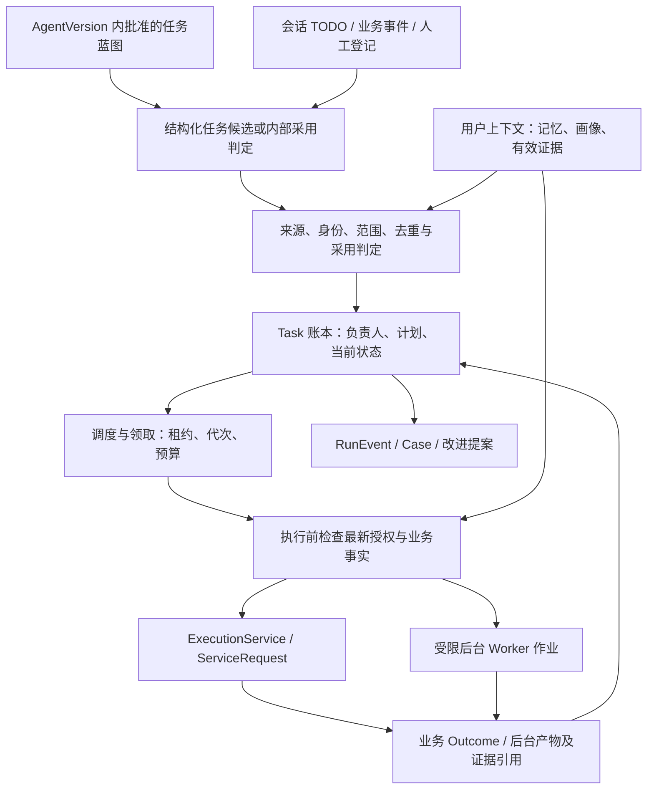

# 客服与销售统一 Task 体系 v0.5

日期：2026-10-23；实现状态回填：2026-10-29。状态：**统一 Task 体系、任务及主动触达策略归属单个专家配置并随 AgentVersion 演进、初始化生成默认事项、受限实例决策及渐进式披露的方案已确定；本版补充 `DurableRunAdapter` 的执行恢复边界；下述完整合同名称、字段、参数和状态机仍为待实现验证的设计。R1 仅实现 M-A-04 所需最小 TaskItem 身份/来源/状态/revision 持久化与未领取事项幂等取消，不等于完整合同已采纳或任务系统已实现**。本版 §9 登记后台设计后继，不建设跨智能体共享策略库，没有启动定时器、真实触达、外部写入或自动调优作业；S1 被动响应范围和既有验收不变。

定位依据见[产品定义](PRODUCT.md)，执行权威见[架构](ARCHITECTURE.md)，与记忆模块的联合依赖见[联合建设计划](TASK-MEMORY-INTEGRATION-PLAN.md)。本设计公开的是可复用抽象和验收条件，不移植任何私有业务配置、话术、接口或代码。

## 1. 产品概念与范围

客服与销售需要管理跨轮、跨会话、跨时间的**服务义务**：某件事为何需要做、对谁做、何时可做、由谁负责、当前为何等待、什么证据证明结束。Task 既可来自运营提前配置的策略，也可来自会话中 Agent 识别的待办；还可由业务事件或获授权的人创建。

Task 是这类义务的结构化记录。自然语言 TODO 是创建它的一种输入，不是执行器。主动触达是 Task 的一种执行方式；核查资料、等待业务结果、提醒人工、复核案例等内部任务无需联系用户，也可以进入相同任务骨架。客服/销售任务与后台配置治理作业分别限权，不扩展为通用项目管理系统。

两个原创虚构例子：

- 客服访客要求“周五下午有结果后通知我”：记录具体事项、时区、结果条件与通知授权，未取得结果前等待，不把“定时到了”当发送理由。
- 销售策略配置“符合某项服务条件时可跟进一次”：产生候选任务；用户在会话中表示暂不方便时，Agent 可在允许窗口内改期，不能自行增加联系次数或变更优惠承诺。

## 2. 统一骨架与对象权威

以下名称是拟定合同，不表示已加入代码。“Task 体系”是产品概念；持久业务事项暂称 `TaskItem`，避免覆盖[既有命名裁决](NAMING.md)中的 `ServiceRequest` 或上游 `RuntimeTask/PlanTask`。正式合同名称仍待评审。

| 对象 | 职责与来源 | 不承担什么 |
|---|---|---|
| `AgentSpec.task_blueprints` | 专家自己的默认任务定义集合，包含目标、触发、依赖、采用规则、完成判据、执行约束及实例可调范围；由 AgentVersion 冻结 | 不引用跨专家共享的可变策略，不直接等于用户事项清单 |
| `TaskPolicy` / `TaskTemplate` | 同一专家任务定义内的策略约束与任务结构；可作为嵌套字段/值对象表达，不设独立发布链或共享注册中心 | 不脱离专家版本独立生效，不允许 Agent 原地覆盖已批准定义 |
| `TaskProposal` | Agent/人工提出的结构化待办、证据、缺口与建议计划；用于进入任务前的审阅或规则判定 | 不持有执行授权；“发现 TODO”不等于可以触达 |
| `TaskItem` | 一项面向确定主体、目的和服务周期的待履行义务；记录负责人、计划、状态、来源/执行版本和关联结果 | 不复制工具执行事实或把模型计划当业务结果 |
| `TaskAttempt` | 一次领取、调度与执行尝试；记录租约/代次、输入快照、预算、执行请求或后台作业引用 | 不以 Worker 返回成功直接宣告 Task 目标完成 |
| `OutreachPolicy` | 专家任务定义内仅对触达事项适用的约束：渠道、身份、许可、时段、冷却、频次、去重、退订与发送回执 | 不成为独立策略平台、平行渠道定时器或联系许可；其他 Task 不必包含它 |
| `ServiceRequest/Outcome` | 原有执行服务处理业务请求及实际结果；Task 调度创建或唤醒请求，结果仍由执行内核裁决 | 不承担全部未来义务的排期、跨任务仲裁或策略定义 |
| `RunEvent` | 记录提出、采用、调整、领取、检查、执行、回执、取消及结果关联；可派生任务时间线 | 不替代持久 Task 当前状态；Trace 抽样不能决定终态 |

一个 `Conversation` 可以产生多个 Task；一个 Task 可对应多次尝试，业务尝试创建或唤醒相应 `ServiceRequest`。已经存在的跨轮业务请求可继续使用，不因新增 Task 再造一个平行业务状态机。后台诊断/候选任务引用 [AGI Worker 作业](AGENT-INTEGRATION-PLAN.md)，其产物是报告或候选，不是生产业务写入。

同一事件账本的 envelope 需要正式扩展以记录 `task_id` 和可选执行关联。当前 S1 `RunEvent` 必须关联 `request_id/run_id`；事项创建、计划变更和取消可能发生在运行之前，不能为了满足现有字段而虚构一次运行。扩展时保证旧回放兼容，不在第二套日志里另存相互矛盾的业务完成事实。

### 2.1 专家内蓝图，不建共享策略库

任务蓝图与专家的服务目标、Skill、资料、渠道、工具和承诺共同编辑、评测和发布。建议 `AgentSpec.task_blueprints` 的每个定义含专家内稳定 `blueprint_key`，以及以下内容：

| 配置组 | 定义内容 |
|---|---|
| 目的与适用 | 业务名称、目标、`internal_todo/outreach` 类型、主体条件与服务范围 |
| 触发与依赖 | 服务初始化、业务事件或受限周期；条件、前置任务、一次性/重复发生语义与停止条件 |
| 采用与完成 | 允许自动登记的内部事项规则、候选审阅要求、记录权限、完成证据判据 |
| 执行边界 | Skill/ToolManifest 引用、时间窗、预算、确认、触达专用约束与失败回退 |
| 调整边界 | 可改字段及取值范围、最大调整次数、需要人确认的情形、人工锁定与取消语义 |

默认初始化只是蓝图的一种触发方式，不要求每件临时 TODO 都预先列出。专家版本也可声明不自动初始化的“临时事项类型”，用参数化目标/输入和明确完成判据、可调包络承接会话/人工的新事项；它仍是该专家自己的批准定义，不是 Agent 随手创造的权限。

`AgentVersion` 必须冻结蓝图及上述有效依赖的版本/指纹；改变默认任务、触发、频次、许可条件或完成标准都形成专家候选版本，走既有评测、审批、Release/回滚链路。`ScenarioPack` 可携带专家的初始配置副本，但不提供会随另一个专家修改而联动的策略引用；复制后各自演进，不建设独立策略市场、继承树或跨专家模板版本体系。

`blueprint_key` 不因普通修订改变；服务目的发生实质变化须新建键并检查语义去重，不能复用旧键掩盖新义务。这里的“冻结”是目标合同；当前 S1 `AgentVersion` 仍是可变 dataclass，尚无蓝图或完整不可变校验。

## 3. 两类入口的归一化



运营策略通过事件/条件产生候选。会话中 Agent 使用受限结构化输出提出待办，携带原始消息/事件引用、目标和缺项；平台采用前核验，而不是从一段总结中自动执行所有“要做的事”。

策略未命中具体主体前保留为配置，不把潜在受众全部物化进用户任务清单。需要 Agent 判断的事项在决策完成前不得被执行队列提前领取；超时、格式错误或条件未知保持阻断并记录原因，不默认发送。

允许的低风险内部任务可按已批准策略自动登记为 Task；这属于既有授权范围内的任务采用，不是 Agent 自授权限。缺确定主体或尚未完成采用判定的内容保留为 `TaskProposal`，不能进入调度领取。已采用的 TaskItem 必须有确定主体、目的与记录该事项的权限；尚缺时间、资料或执行许可时可等待条件，不要求这些缺口被模型补齐。对外承诺、联系和有副作用工具仍满足独立授权与确认。

会话 TODO 或人工新建事项采用前，也须绑定当前执行专家版本内适用的蓝图/临时事项类型，实例参数不能越出其完成判据、工具和调整包络。Proposal 可暂缺 `blueprint_key` 并显示“不匹配批准类型”；这时不能采用为可执行 TaskItem。人选择采用不是补造缺失的执行合同，新增类型须进入专家草稿/版本链路。

### 3.1 服务初始化与幂等

“创建专家”只创建配置；“服务初始化”是在已确定主体的一个服务周期中绑定有效专家版本、评估该主体适用的默认事项。两者不等同，也不在每条消息、重连、新 Conversation 或版本升级时重建清单。

1. 平台确定 `tenant_id + agent_id + subject_id + service_cycle_id`；服务周期由业务规则/有权人员管理，模型不能自行开启新周期来重置联系次数。
2. 只评估当前主体命中的蓝图。身份、条件与记录权限完备的低风险内部事项可按批准规则直接采用；缺项保留候选或等待原因，不猜测用户身份或补造授权。
3. **任何触达意图先形成 TaskProposal**。采用由已批准的确定性规则或有权人员判定；规则准许自动采用也必须保留候选与采用证据，不把 Agent 选择“适合联系”视为批准。执行许可仍在实际动作前重验。
4. 条件未成立的定义保留为配置；周期任务只为已到达、命中且仍有效的 occurrence 有界生成候选，不为潜在受众或无限未来展开任务。
5. 初始化/事件采用与事件记录事务化。建议来源键为 `tenant + agent + subject + service_cycle + blueprint_key + occurrence`，**不把 AgentVersion 加入产生新事项的去重维度**；版本留作来源证据。初始化 occurrence 固定为该周期/蓝图的初始化发生项，不使用本次消息/重连/运行 ID；事件 occurrence 来自可信来源事件，周期项来自稳定排期时槽而非收到 tick 的时刻。同一周期重复初始化或换版本不重复造事项。新的合法业务周期仍接受跨事项语义去重和总频次检查。

匿名身份仅在明确租户/专家/会话作用域及记录授权下解析；主体尚未确定时只保留受限候选，不进入公共匿名桶或可领取队列。身份合并/拆分重新核验事项归属、去重与权限，不依赖模型姓名匹配。

## 4. 动态调优的边界

| 变更层次 | Agent 可以怎样参与 | 生效方式 |
|---|---|---|
| 单个 Task 的运行计划 | 在批准的时间窗内改期、按当前事实选择允许步骤、延期等待、减少无效跟进、向人建议升级 | 规则验证后生成新 Task revision，记录原因、来源与代次；不得越出策略边界 |
| 人工已锁定的单个安排 | 提出变化建议，展示冲突或已过期依据 | 有权人员确认；默认不覆盖人工安排 |
| 可优化表达与处理策略 | 提出 SOP/话术/澄清顺序、有限检索参数的候选 | 沿用 `ChangeProposal`、固定评测、审批和版本发布 |
| 专家蓝图内的 `TaskPolicy` / `OutreachPolicy` | 从结果诊断策略效果并提出修订，不原地改现行策略 | 随专家候选版本提交差异、适用样本、独立评测/沙盒、人工审批；在途任务有显式迁移决定 |
| 授权、最大频次、冷却下限、承诺/价格、硬规则、结果定义、审批权 | 只能标出问题并提出待审项 | Agent 不得静默修改；平台持续模型外裁决 |

不把每次保守改期都变成整个平台发布，也不把“动态调优”变成全量策略自改。允许自动调整哪些字段、取值范围、确认条件、最大调整次数和预算都要在候选运行前登记；当前参数待验证。

策略更新不自动改写旧 Task。迁移须说明：继续原批准范围、重新按新策略检查、暂停/取消或由人承接。涉及授权与停止条件的最新变更立即作用于执行检查，不能因引用旧策略版本而继续联系已拒绝用户。

### 4.1 Agent 决策不等于多调用模型

事件和调度器先以确定性规则过滤主体、条件、时段、去重、占用与权限；只有确有不确定选择时才请求 Agent 判断。已明确等待的任务不按每次时钟 tick 重新推理。一次决策只面向有界工作集，可保持计划、在允许窗口内改期、选择已批准步骤、提出新事项、请求信息或升级人工；取消只提交请求，不能自行写最终状态。

每次变更携带基础 revision、依据引用、幂等键和允许调整范围；过期建议、人工锁定、越界改期/增加次数/改承诺一律拒绝或转人工。取消请求也须满足批准的停止条件、明确用户撤销或有权人员决定；不满足时只保留建议/待人审，不因尚未执行就允许 Agent 丢弃服务承诺。影响动作或确认内容的改动使旧确认、旧决策及尝试代次失效；不需要为纯展示字段变更取消全部工作。仅保存简明理由与证据引用，不要求保存模型隐藏推理。

### 4.2 发布、在途迁移与回滚

Task 保留 `source_agent_version` 与 `execution_agent_version`：前者解释为何创建，后者固定下一次实际执行使用的已批准配置。请求一旦开始不在中途切换 AgentVersion；后续尝试换版本必须先有迁移记录和重验。

发布新专家版本只影响后续明确绑定/初始化，不重建既有服务周期或静默迁移在途任务。发布预览展示新增/删除蓝图和受影响候选、等待/运行事项；逐批明确选择：保留仍获准且依赖可用的旧执行版本、迁移到新版本并重验、暂停，或按取消/人工承接流程处理。运行中任务先协调停止和实际结果，不能直接换配置继续。

删除蓝图不删除服务义务；被停用版本或缺失工具/Schema 的事项必须等待/交接。回滚不抹除任务 revision、实际结果、频次/冷却计数，也不复活已取消事项、已撤回授权或已删除资料。当前退订、最新权限撤回及平台硬上限始终优先于历史版本的允许条件。

## 5. 最小 Task 合同建议

| 字段组 | 必要信息 |
|---|---|
| 身份与范围 | 稳定 `task_id`、`tenant_id`、`agent_id`、确定 `subject_id`、`service_cycle_id`、目的、所有者/执行角色；待解析身份仅属于未采用 TaskProposal |
| 来源 | `operator_policy/conversation_todo/business_event/manual` 类型、来源事件/消息 ID 和版本、提出者、采用方式、关联 `Conversation` |
| 配置依据 | 专家内 `blueprint_key`、`source_agent_version`、`execution_agent_version`、蓝图/依赖指纹、允许动作/工具引用、完成判据、可调范围与预算；无独立共享策略版本权威 |
| 排期 | 显式时区、最早/最晚可执行时间、期限、条件触发与依赖；模糊时间保留待澄清而不猜测 |
| 动态状态 | Task revision、原因、负责人、计划变更历史、阻断原因、取消请求和实际确认 |
| 尝试与证据 | attempt ID、领取租约及代次、来源 occurrence 去重键、有效事项语义去重键、逻辑动作副作用键、ServiceRequest/作业 ID、所用上下文快照、回执及结果标识；副作用键跨 TaskAttempt 重试保持稳定，不以新 attempt/run ID 生成新键 |
| 数据与撤销 | 权限/许可引用、来源有效期、撤回/遗忘关联、数据保留与跨实例迁移状态 |

所需事实引用[用户上下文模块](USER-CONTEXT-DESIGN.md)；执行时读取当前有效事实，保存本次快照与来源版本，不把创建时画像复制为永久真值。

## 6. 状态与完成判据

以下是语义状态提案，正式枚举仍需合同评审：

```text
TaskProposal：proposed → awaiting_approval / awaiting_identity → accepted / rejected
accepted 后创建 TaskItem，候选本身不可领取

TaskItem：waiting_condition / scheduled → ready → running
                                      ↓          ↓
                  waiting_input / waiting_result / waiting_human / retry_wait
                                                   ↓
                                     succeeded / skipped / failed / reconciling

未执行任务可 superseded / expired / cancelled
运行中取消：cancel_requested → cancel_pending → 按停止确认及实际结果裁决
```

排期、领取、执行与业务结果分别记录；租约可以作为尝试字段而非再增加一个对用户暴露的状态。时间到只表示可检查，不保证满足条件；超时、挂断或生成完成均不能直接写为业务成功。

`unknown` 是结果性质，Task 进入 `reconciling/待人工核验`，禁止自动重复副作用。核验后依证据转入成功、失败或已取消；无法核验时继续等待并显示原因。收到停止确认且完成判据尚未满足时可以判已取消；动作已完成、供应商已受理或停止未生效时，保留实际结果与取消未生效事实，不能把“执行已停止”统一记为“事项已取消”。

`skipped` 只在已登记的实例跳过/停止条件满足时使用，说明本次不执行及依据，不计为已发送或已解决。临时不方便通常应等待/改期；有明确服务承诺的事项不能仅凭模型判断“不值得联系”而跳过。

完成判据在任务创建前定义。例如“通知某结果”的目标可以要求有效消息送达证据；“完成预约”必须有预约持久结果及外部 ID；“核查政策”要求可追溯的核查结论；“生成改进候选”要求产物落库，不要求也不暗示已经发布。业务完成由相关 Outcome/产物证据支撑，Task 终态是其派生裁决。

用户说“我已经处理了”可作为带来源的声明进入核查；是否足以结束任务由预定判据决定，不默认为外部业务已完成。人工接管只改变负责人/占用，不能自动取消服务义务。

### 6.1 对外状态投影：内部多态，对外五值（2026-10-21 定）

内部状态按上文继续演进（正式枚举仍待合同评审），但**页面、筛选器、通知文案与对外接口只认五个投影值**：

| 对外投影 | 含义 | 当前对应的内部状态 |
|---|---|---|
| `submitted` 已提交 | 已受理、尚未开始执行 | `waiting_condition`、`scheduled`、`ready` |
| `working` 处理中 | 正在执行，或等待外部结果 | `running`、`retry_wait`、`waiting_result`、`cancel_requested`、`cancel_pending`、`reconciling` |
| `input_required` 需补充信息 | 缺执行所需信息，或等人工承接 | `waiting_input`、`waiting_human` |
| `auth_required` 需授权 | 缺权限/许可，或授权撤回导致阻断 | §7 第 2 条的预留失败、来源撤回 |
| `terminal` 已结束 | 业务事项已有结论 | `succeeded`、`skipped`、`failed`、`cancelled` |

规则：

1. **投影是唯一对外口径。** 列表、筛选、通知只出现五值；内部状态只在任务详情出现，且必须标注为"内部状态"，不得进入筛选条件与通知文案。
2. **新增内部状态必须显式登记投影**，测试对未登记状态判失败；运行时兜底落到 `working`，不允许出现空白或"未知"占位。
3. `reconciling` 投影为 `working` 而**非终态**：外部结果未知时不能向用户显示"已结束"。
4. `cancel_requested` / `cancel_pending` 同样投影为 `working`；取消是否生效另以事实呈现，沿用 §6 末段口径。

理由：内部状态机还会变，对外口径不能跟着变；而"排队 / 执行 / 重试"的区分对搭建者是诊断信息、对使用者是噪音。投影不改变内部状态语义，也不改变"业务完成由 Outcome 证据派生"的判据。

## 7. 调度、仲裁与恢复

1. **持久账本与事件去重**：同一业务事件重复到达、同一会话候选重提或跨渠道重复需求，按主体、目标、来源事件、业务对象和有效期判断复用、合并或冲突；不只比较文本相似度。默认蓝图与会话 TODO 命中同一义务时，兼容则复用并补来源；计划/权限/判据冲突则留候选待审，不通过合并扩大原事项权限。
2. **跨任务仲裁**：同一主体正在人工服务、正在通话、已完成相同目标或刚收到一次跟进时，检查是否合并、延期或停止；策略任务与会话 TODO 不能各自绕过总频次和占用。发送前按登记的租户/主体/渠道/目的计数作用域原子预留共享额度与占用，不能让两个不同 Task 各自“查到还剩一次”后同时发送。预留绑定逻辑动作幂等键/代次，执行前重验；失败释放、实际消费和取消不退款的口径预先定义并留证。未知外部结果保留待对账占额，租约到期不自动当未发释放。共享运行额度是安全基础设施，不是共享策略库，各专家仍只有自己的版本化蓝图。
3. **领取、替代与代次**：多个 Worker 通过持久租约竞争；每次发送/写入前校验当前 Task revision、执行代次、取消与占用。失效 Worker 的迟到输出不能继续产生新动作。替代任务先保持未激活；原事项在本地与执行端已可靠阻断后才激活替代。供应商已受理且无法撤销时记录取消未生效，不能立即执行替代造成双重联系。
4. **事务边界**：任务采用、调度意图与事件用事务/outbox 关联；外部操作在可用时使用供应商幂等。重试次数或普通改期次数不能成为新业务副作用的理由。
5. **未知结果先对账**：外部请求可能已执行但回执丢失时，先按关联 ID 查询/核查；没有可靠去重或对账能力时停止自动重试，交人工。不能仅靠本地幂等表宣称跨系统恰好一次。
6. **取消与过期**：未执行任务可阻止后续调度；执行中必须请求停止并取得确认。已发送消息、已接通电话或已发生写入不能因 UI 取消而假装撤回。期限过了也不能把仍在执行的尝试直接终结。
7. **重启/备份**：任务、租约代次、幂等、授权撤回、结果与版本关联一起恢复；恢复后先检查当前事实，不能批量补发所有过期触达。

Task 账本与调度服务始终在 Loomrise 应用边界内；队列或耐久执行框架可以替换，SDK 内部线程、step/task 状态不成为业务终态。

### 7.1 重启恢复裁决表（2026-10-21 定）

上文第 7 条只给"一起恢复"的原则，实施时会各按理解处理，故落成裁决表。**裁决分三层，不可混为一谈**：`TaskAttempt`（这次尝试）、`TaskItem`（这件业务事项）、外部副作用（已发生的调用、通话、写入）。参照实现的五动作矩阵是单层任务记录，这里按三层重写。

| 重启时的状态 | 尝试（TaskAttempt） | 事项（TaskItem） | 外部副作用 |
|---|---|---|---|
| `waiting_condition` / `scheduled` / `ready` | 无有效尝试，执行时新建 | 恢复调度，**执行前重检条件与授权** | 无 |
| `running` | **一律 `failed`**，原因 `restart_interrupted` | 副作用确定未发生 → 可重新排期；未知 → `reconciling` 待对账 | 按 §7 第 5 条先对账，不自动重试 |
| `waiting_input` / `waiting_human` / `waiting_result` / `retry_wait` | 保持等待，不起新尝试 | 原样恢复 | 无新增 |
| 已委派且执行端可查询 | **重新挂接**，沿用原顶层 ID | 原样恢复 | 不重复发起 |
| 已委派但仅部分可查 | **全或无**：不能全部重挂则全部判失败 | 按上列规则处理 | 不部分重挂、不回退旧顶层 ID |
| `cancel_requested` / `cancel_pending` | `failed`（中断） | **不因重启记为已取消**；按停止确认与实际结果裁决，未确认则 `reconciling` | 记录"取消未生效"事实 |
| 终态 | — | **不复活** | 不补发 |

四条铁律：

1. **重启不重跑。** `running` 一律判失败，不"假装还在跑"，也不自动重跑——一次重复外呼是合规事故，一次重复写入是数据事故。可重试的是**事项**（重新排期、新建尝试），不是让旧尝试复活。
2. **失败率上升属于诚实记账。** 不得为压指标把判失败的尝试改成"自动重试"，也不得在页面上把 `restart_interrupted` 折叠进普通失败。
3. **外呼专属：已接通的通话，重启后不得恢复为"未呼"**，必须记为"通话中断"并保留实际结束原因；是否重呼由策略窗口与人工决定，系统不自动重拨。
4. 本表是 S2-a 持久化与恢复门的前置：**先定表，再落存储**。

依据见[源码研读](QWEN-AUDIO-AGENT-HARNESS-STUDY.md) A4。

### 7.2 执行耐久 Adapter 边界（规划）

`pi durable` 提供了值得借鉴的原子提交、checkpoint、sleep/wake、有限 retry、abort、crash-loop parking、嵌套任务和只读检查机制，但这些机制只能进入 `DurableRunAdapter`。对象映射分成两个维度：`ServiceRequest → Run → runtime_execution_id`，以及 `TaskItem → TaskAttempt → Run` 关联。`ServiceRequest` 跨轮次聚合业务请求，`Run` 是一次冻结版本/上下文/策略快照的执行尝试，`TaskAttempt` 负责事项领取与 lease/generation，`runtime_execution_id` 只在 Adapter 内部追踪 task/phase/checkpoint。

Adapter 的恢复、重放、重试和挂起不创建第二套 Task 或业务完成状态。执行前仍要重验权限、确认上下文、AgentVersion、预算和 generation；执行后的 `result_id`、`Outcome`、`UNKNOWN` 对账和 `RunEvent` 才能决定业务结果。Adapter abort 只表示停止内部运行，不能推导业务撤销；旧执行者的迟到输出必须拒绝。R1 先验无副作用步骤的持久提交与恢复（若选用 checkpoint，则验证其可见性），R2 再验确认等待/取消/未知对账，R3/R4 才验跨进程 Worker 接管与 parking，S3 才验云端存储、备份和迁移。详细步骤见[DurableRunAdapter 实施计划](superpowers/plans/2026-10-23-durable-run-adapter.md)。

本节不覆盖 §7.1 的裁决：本地 `running` 尝试重启后仍记 `failed/restart_interrupted`，只能由获准的新尝试关联新 `Run` 并引用输入/版本兼容的安全提交结果；已持久等待态及执行端可完整查询的委派按原表恢复或重挂。未提交的纯计算允许重算，已提交业务事实按提交记录复用而不重复入账；模型调用、实时检索等外部读取另行定义复用/重调、时效和预算策略。外部副作用保持逻辑动作幂等键，未知先对账。耐久层也可用于无 Task 的入站请求，不把完整 Task 调度器变成 R1 前置。

## 8. 主动触达与外呼经验的可迁移部分

可迁移的是触发事件、服务目的、可执行窗口、冷却/去重、接管/占用、停止、回执和结果分层。业务特有的人群规则、字段、周期、话术和供应商私有协议通过场景包/Adapter 表达，不进入公开默认模板。

主动服务应以具体服务义务和授权为起点。用户偏好、兴趣画像或 Agent 判断“现在联系可能更有效”，都不能独立生成触达许可。没有可用的对外渠道时，Task 可等待或提醒获授权的人工，不能静默换用其他渠道。

电话采用独立媒体尝试与 `call_id`：拨打、振铃、接通、结束、转写、人工承接与业务结果分开；乱序/重复回执不能使任务回退或重复拨号。电话仍按 S4 的独立授权试点验收，不因 Task 模块存在而提前宣称支持。

## 9. 工作台与客服应用需求

- **专家版本配置**：建议在专家配置内提供“任务与主动服务”，人定义目标、默认任务、触发、停止、窗口与可调范围；默认业务摘要，再展开条件/决策，最后查看完整合同/证据。与当前专家共用版本差异、评测和发布，不新增全局共享策略库。专家初次搭建不要求先配置主动策略。
- **服务事项（统一任务清单）**：按主体、服务周期、目的、负责人、状态、期限和来源筛选；统一呈现策略任务与会话 TODO，默认不因编辑草稿而隐藏其他来源/执行版本的未决义务，能看待确认、等待、冲突和取消确认。
- **任务详情**：解释为什么创建、为什么现在执行/等待、谁可改、参考哪些记忆、发生过哪些尝试、最终有什么证据。
- **坐席协同**：Inbox 查看当前服务义务，明确承接/改期/取消权限；一线提名不授予策略发布或事实审定权。
- **策略改进与迁移**：按固定样本和任务结果比较，展示蓝图改动与在途影响；单次发送量或模型完成率不能代替业务结果，无新证据不启动无限优化循环。用户事项调整与专家蓝图编辑分开呈现，不能误把改期保存成全体用户的新默认策略。
- **完整人工路径**：人可创建、查看和管理获准任务；Agent 是协作者，故障不使义务丢失或当前服务不可用。

页面/导航已形成增量设计，见[体验设计 §12](CONFIGURATION-UX-OPTIMIZATION.md#12-专家任务与-harness-的后台增量设计)、[IA §8](S2-IA-NAV.md#8-taskharness-后台增量落点)与[后台工作包 §8](S2-CONSOLE-KICKOFF.md#8-taskharness-后台增量工作包)。保留四组/三深度，在专家版本内配蓝图，在运行与验收组管理“服务事项”，Inbox 共用同一实例服务；UI/正式服务均未实现，本轮不改原型菜单或完成记录。

### 9.1 小工具面与任务工作集

以下是待实现的语义工具建议，不是新增一组 CRUD API：

| 模型入口 | 职责 | 不允许 |
|---|---|---|
| 系统装配的任务工作集 | 每轮提供当前主体、目的相关事项/候选、下一步和阻断摘要；不是一个必须先调用的 Tool | 不全量塞入历史或把提示词子集当全局调度状态 |
| `inspect_context` | 按已授予的对象引用有界展开任务、相关事实、蓝图/Skill 或证据；分页并记加载依据 | 不任意查询其他主体、猜引用越权读取或返回整个工具目录 |
| `manage_tasks` | 用类型化 `propose/adjust/request_cancel` 提交任务意图，共用基础 revision、依据、幂等和服务端校验 | 不任意 `set_status/mark_sent/mark_completed`、硬删除、写 cron/代码或改权限；取消请求不冒充停止确认 |

`manage_tasks` 同一主体/服务周期内的耦合变更采用原子校验与提交：任一项冲突或越界则整批拒绝，不半途应用“取消并替换”；外部停止不属于数据库原子事务，替代事项在取得原事项可靠阻断证据前仍不得激活。不同主体拆批；不提供跨租户批量万能操作。

实际发送、业务写入及其确认仍保留独立语义 ToolManifest 和 ExecutionService，不合并成万能 `execute/invoke`。应用服务内部可有查询、修订、领取消费等接口，但不必逐个变成模型工具。外部创作 Agent、后台 Worker 与在线客服的可见操作按角色分别裁剪；相同工具名不授予相同权限。

工作集取以下并集后限额：当前路由相关事项/候选、配置前瞻窗口内将到期事项、相关逾期/待对账/阻断义务，以及避免重复执行所需的近期完成/发送摘要。未决项保留稳定 ID、来源/版本、目标、计划摘要、前提缺口和可调范围；完成项仅给结果事实与必要引用。已发送不等于业务目标已完成。

全局去重、频次、占用与未决义务仍查持久账本；不能因事项未入本轮工作集就放行重复联系。若关键停止/权限事实加载失败，阻断相关动作，不以预算裁剪或“模型没看见”放行。

### 9.2 贯穿 Harness 的渐进披露

常驻身份、安全/确认摘要、有界工作集和最小能力摘要；选中任务/Skill 后才加载相关蓝图、必要事实、允许调整字段及所需 Tool Schema；详细历史与结果按需展开。保护信息不能被预算挤掉，超预算时缩小任务范围或等待。工具/Schema 的可见集合、ID、版本/哈希、权限依据及加载/跳过原因进入输入快照和审计，避免只记录“用了某工具”却无法还原模型当时所见。

发现不等于授权：猜中隐藏工具名、使用旧 Schema 或在读取后权限被撤回都不能执行。若 Adapter 不支持轮内动态工具，使用每次运行固定的最小授权子集；扩展时建立显式新快照/运行边界，不默认暴露全目录，也不用万能调用器绕过限制。具体接入职责见[Agent 接入计划](AGENT-INTEGRATION-PLAN.md)。S1 只有最小三段式上下文选择，当前工具仍固定装配，尚未实现此处工具渐进披露。

## 10. 必要验收与阶段

| Gate | 必须证明 |
|---|---|
| 专家版本归属 | 蓝图、触达约束与 Skill/工具随专家版本冻结；修改另一专家不联动；无可变共享策略引用 |
| 初始化与周期 | 同周期重复初始化/重连/版本变化不重复创建；低风险内部事项可按规则登记，触达先候选再采用；缺身份/条件/授权不调度 |
| 双来源归一 | 运营策略和会话 TODO 能形成同一 Task 合同，各自保留来源与采用依据 |
| 权限与调整 | 允许窗口内改期留证；越界、增加次数、改承诺和覆盖人工锁定被阻断 |
| 去重与竞争 | 重复事件/候选、双 Worker、跨渠道相同目标不导致重复副作用 |
| 跨事项额度 | 两个不同 Task 并发且总额度仅一次时最多一次获准；未知发送保留占额，对账/取消/旧 Worker 不造成错误释放或双发 |
| 停止与未知 | 取消确认、过期、失效代次、回执丢失分别可复核；未知结果不自动再发 |
| 记忆联动 | 来源撤回、用户更正、拒绝触达、身份变更使相关待办重新检查或停止 |
| 业务结果 | 实際结果/产物 ID 与任务判据关联，接通或答复生成不冒充目标完成 |
| 状态投影 | 对外只出现五值；新增内部状态未登记投影时测试失败；`reconciling` 与取消中不投影为终态 |
| 恢复与版本 | 重启/备份后不复活取消任务；重启被判失败的尝试不自动重跑；已接通通话不恢复为未呼；策略回滚不恢复撤销授权或撤销外部写入 |
| 在途迁移 | 新版本/删蓝图不默迁义务或中途换运行版本；暂停/迁移留证，频次与停止事实跨回滚保留 |
| 工具与披露 | 隐藏工具猜名、旧 Schema、超范围读取被拒；保护项不被裁剪；不支持动态工具的 Adapter 按固定最小子集降级 |
| 工作集与成本 | 当前/将到期/待对账事项覆盖正确；同模型、样本、预算下比较全目录与渐进披露的质量、Schema/结果 token 和额外往返，不预宣称节省 |

建议 S2-a 定义主体、Task/来源和持久化合同；S2-b 完成内部 TODO 与人工任务沙盒；S2-c 验收受限调度、策略候选与授权渠道沙盒；S3 验收自有云持久恢复；S4 再验电话与跨租户扩展。阶段建议以[联合计划](TASK-MEMORY-INTEGRATION-PLAN.md)对齐现行 Gate，尚无新增实现证据。

## 11. 研究证据与开放决定

公开框架与本地授权经验的研究范围、来源、可借鉴机制和限制见[联合研究与建设计划](TASK-MEMORY-INTEGRATION-PLAN.md)。引用仅证明参考机制存在，不证明 Loomrise 已采用框架或实现同等能力。

本轮已决定归属、初始化、实例决策、版本迁移和最小语义工具/披露方向；具体字段/API 名称、各场景自动采用清单与调整数值、前瞻窗口、完成判据、保留期限及生产调度/存储构件在实施测试中定版，不重新引入跨专家共享策略。首片先以虚构主体验证版本内蓝图、幂等初始化、内部事项管理和有界工作集，不发送真实消息；文件级实施安排见[首片实施计划](superpowers/plans/2026-10-16-expert-task-harness.md)。

**2026-10-21 另定两项**：对外状态投影（§6.1）与重启恢复裁决表（§7.1），依据 [Qwen-Audio-Agent 源码研读](QWEN-AUDIO-AGENT-HARNESS-STUDY.md) A1 / A4。两项只补"对外怎么显示"与"重启怎么办"的操作口径，不改变本文其余结论，也不改变内部状态机的最终枚举。
