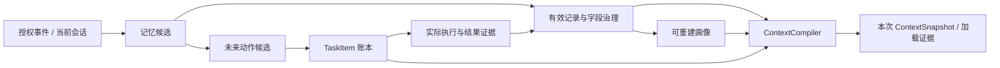

# 用户上下文模块：记忆、画像与上下文管理 v0.3

日期：2026-10-16。状态：**独立建设用户记忆、画像与上下文治理模块的产品方向已确认；对象、服务接口、字段规则和 Provider 选型仍为提案，未实现**。本轮补充专家版本任务工作集与工具渐进披露的装配边界，没有安装记忆系统、接通模型或修改 S1 代码。当前三段式加载有最小实现，跨会话用户记忆、画像治理、自动压缩和完整持久化均不能据此宣称完成。

本轮（2026-10-16 第二次更新）新增：把 **Tencent Hy Memory 2.0** 列为并列具名候选并完成三层裁决；明确「业务用户记忆（本模块）＋专家记忆＋个人记忆」三者必须分开；身份合同由 3 个扩到 5 个（新增专家身份与合并/拆分可逆）。见[Hy Memory 三层裁决](HY-MEMORY-LAYERED-ANALYSIS.md)与[专家-用户记忆体系](EXPERT-USER-MEMORY-SYSTEM.md)。**本模块的既有结论未被改写。**

本文件负责系统职责与治理设计。[既有记忆内核提案](MEMORY-FOUNDATION-DESIGN.md)保留 TencentDB Agent Memory 的历史核查与候选方案；[Hindsight 研究](HINDSIGHT-ITERATION-ANALYSIS.md)保留经验归纳参照。两者均未构成已批准/已联调的默认内核。Task 义务由[统一任务体系](TASK-SYSTEM-DESIGN.md)管理，分期见[联合计划](TASK-MEMORY-INTEGRATION-PLAN.md)。

## 1. 统一体系，保留数据权威

用户记忆记录过去有来源的信息；画像回答当前有效信息如何描述此用户；上下文回答这次运行究竟看到了什么。三者共享身份、来源、用途、时间、版本和撤销治理。它们不是三套相互拷贝的数据，也不与知识库、任务和权限合并为一个自由文本记忆库。

| 信息 | 权威及保存方式 | 在模型上下文中的地位 |
|---|---|---|
| 当前会话与原始事件 | 受授权的会话/事件记录，按保留策略处理 | 本轮输入与可回查来源；不要求永久保存所有原文 |
| 用户陈述、偏好与经历 | 带陈述者、主体、时间、证据的 `MemoryEntry` | 表明“用户曾说明”；不自动成为外部已验证事实 |
| 订单、价格、支付与工具结果 | 对应业务系统与 `Outcome` | 精确读取、记录结果 ID 和新鲜度；模型抽取不得覆盖 |
| 产品知识与 SOP | 版本化知识和 `AgentVersion/SkillManifest` | 受来源和版本约束；不自动成为个人记忆或画像 |
| 用户画像 | 从当前有效记录派生的 `ProfileView` | 可重建、有字段证据；不是第二份事实源 |
| TODO、未来承诺与执行状态 | `TaskItem/TaskAttempt` 与相关请求/结果 | 查询结构化任务账本；记忆仅保存引用与经历 |
| 本次上下文 | `ContextPlan → ContextSnapshot` 与加载账本 | 冻结实际提供给模型的内容及未加载原因，不授予权限 |
| 跨用户成功/失败经验 | 独立隔离的经验分析资产 | 诊断和候选依据；不将群体规律填成某用户事实，不自动发布 Skill |

“把下一次联系时间写进画像”不能代替任务排期；“记得用户想买”不能代替触达许可；“摘要说已完成”不能代替业务结果。

## 2. 模块边界与接口候选

建议以一个 **`UserContextService` 责任模块**对外提供应用用例，内部按职责拆分，不要求部署成多个微服务。网页、API、MCP、CLI 与受限 Worker 共用相同合同。

| 内部职责建议 | 输入/输出与权威 |
|---|---|
| `IdentityScopeResolver` | 从受信身份与用途确定主体/租户/服务范围，处理关联、合并/拆分和关系授权 |
| `MemoryCaptureService` | 接收授权事件，提出带证据的记忆候选和 TaskProposal；异步作业有幂等与回执 |
| `MemoryFactService` | 版本化字段、来源、事实性质、冲突、更正、有效性和归属；Loomrise 管治理元数据和候选采用 |
| `ProfileReadService` | 按当前任务字段需求精确读取有效值，输出缺失、冲突、新鲜度和依据；画像是派生投影 |
| `MemorySourceAdapter` | 封装 Provider 存储/提炼/检索、返回版本和错误，不能私自注入 Prompt 或接管身份与权限 |
| `ContextCompiler` | 合并当前输入、任务状态、精确字段及合法检索片段，按预算形成 ContextPlan/Snapshot |
| `ContextCompactionService` | 在 Loomrise 编排下压缩并保留覆盖/移除证据，不接受未留证的上游隐式改写 |
| `RetentionService` | 更正、撤销、forget、派生失效、迟到作业代次与删除回执；数据保留和可继续使用分别处理 |

这些是职责及接口候选，正式字段和 HTTP/MCP 方法尚待登记。外部创作 Agent 只能读取获准范围、提交候选，不直接写记忆数据库、合并身份或批准画像事实。在线客服和后台抽取/治理 Worker 分开身份、预算及工具。

## 3. 身份是首个前置合同

当前 `ServiceRequest` 有租户、AgentVersion 和请求关联，缺稳定业务用户标识；当前 `ContextFragment` 缺完整主体、用途及撤销语义。不能靠增加一个记忆 SDK 把这些缺口自动补齐。

建议基础隔离范围为 `tenant_id + application/service_scope + subject_id`。实际 Provider namespace 映射须实测；业务用户身份与 AgentVersion 分开：稳定主体承载跨会话连续性，当前 AgentVersion、字段/策略版本绑定每次读取和快照。新增版本不能默认把所有记忆割裂，也不能因此允许跨 Agent/服务范围共享。

- 匿名访客使用会话作用域，不能把不同匿名访客放入公共默认桶。
- 区分陈述者与被描述主体，以及本人、代理人、坐席、群成员等关系；“谁说的”不一定是“说的是谁”。
- 跨渠道关联依赖受信业务映射或明确验证，不以昵称、号码相似度或模型实体合并代替。
- 合并/拆分保留原映射、关联依据与可逆操作记录，重算权限、任务归属和上下文可见性。
- 多租户正式隔离仍按阶段验证；首期单租户也必须有显式主体和作用域，不能用单实例演示宣称多租户通过。

旧记忆提案中的 `agent_id ← agent_version` 是待确认映射，需加入跨版本连续性对照；本轮未把某种新映射直接设为已验证默认值。

## 4. 结构化记忆与字段定义

字段库管理定义，用户记录管理具体值。建议采用“原始事件引用 → 带证据候选 → 有效记录 → 当前画像 → 本次上下文”的链路，避免不停覆盖一份 `persona.md`。

| 字段组 | 最小合同建议 |
|---|---|
| 归属与可见性 | 稳定 memory ID、租户/主体/应用范围、陈述者与主体关系、允许用途、读者范围 |
| 内容与性质 | `field_key/schema_version/value`、`user_asserted/system_observed/derived/inferred`、未知/冲突标记；推断评分不等于真值 |
| 来源 | 原事件/消息/工具结果 ID、来源版本/内容哈希、依据片段、抽取器/模型版本、原始与派生关系 |
| 时间 | 发生/接收/抽取时间、有效起止时间、保留期限、业务对象/阶段范围；时间格式含显式时区 |
| 状态 | `candidate/pending_confirmation/active/superseded/expired/revoked/forgotten`、revision、被更正记录 ID 与原因 |
| 关联 | request ID、TaskItem ID、结果 ID、画像/快照引用、撤销代次和异步操作 ID |

不同性质采用不同字段规则：系统业务事实回查业务权威；低风险明确自述可依预先登记规则采用，避免每条普通偏好都走人工审批；推断保留候选/派生性质。身份关联、授权、价格与业务承诺不能由模型提取结果直接批准。

提取出的未来动作进入 `TaskProposal`，不成为一个能直接执行的画像字段。记忆写入响应、提炼完成、候选采用、画像刷新分别记状态；模型说“记住了”不是落库证据。

## 5. 更正、冲突、过期与遗忘

1. **明确更正**产生新 revision，保留更正对象与来源，使旧值及其派生视图不再作为当前值；不能用简单最后写入覆盖处理所有乱序事件。
2. **普通冲突**保留双方依据并标待确认；同一业务范围的矛盾价格/时间/状态不能按更高模型分数自行选择。当前正确来源与明确更正优先级需按字段登记。
3. **重复证据**按原事件、语义范围和业务对象去重；重复转述不能增加独立支持样本数。
4. **有效期与保留期分开**：过期记录可能依授权保留，但不能用于当前动作。非法日期、缺时区、缺必要有效性或撤销信息不能被视为可安全使用。
5. **用户撤销/forget**使受影响检索、画像、缓存和后续快照失效；原文及派生资产按规定清理并保存必要的操作元数据，不以“不可变审计”为由无限保存用户内容。
6. **异步迟到**写入前核验主体、来源和撤销代次，防止抽取结果复活已删除信息；备份恢复必须重新应用删除/撤销标记。
7. **任务联动**：撤回某条记忆不自动删除仍存在的服务义务。相关 Task 重验；缺必需身份、授权或事实时阻断、暂停或交人工，取消成功另等执行确认。

历史 ContextSnapshot 的读取证据不可被改写成另一段历史；其中内容仍受保留策略管理。已撤销快照不得被当作缓存重新投喂模型。审计可保留脱敏 ID、哈希与删除操作范围，实际原文保留/清除以明确策略和回执为准。

撤销同时使受影响的 SDK/harness 会话历史、工具结果内容和派生/压缩摘要失效；下一次模型调用须重建或过滤并核验来源代次。实际输入快照必须包含合法复用历史，不能只记录本轮新加载片段；无法证明复用历史来源与有效性时，不得直接沿用旧模型会话状态。

## 6. 任务与记忆的双向关联

Task 保存源事件/记忆引用。执行前精确重读必要条件与许可，并核验 Task revision 和占用代次；创建时的画像只作为历史依据，不永久冻结为用户真值。任务实际完成后可以记录经历，完成来源必须是结果权威。

用户改期同时影响记忆偏好与某一任务计划时，通过应用服务形成可对账的事件与修改，不让两个数据库各自推断完成。去重、频控和跨任务仲裁查完整任务账本；Prompt 只加载当前相关事项，不能承担全局调度。

## 7. 上下文装配与检索预算

沿用六层及“常驻基线 → 当前任务/Skill → 按需证据”的加载结构。模块的输出进入 `ContextSnapshot/ContextFragment`，不增加第七层，也不把 Memory Provider 变成业务执行内核。

装配顺序建议：身份与用途校验 → 当前消息 → 当前请求/事项结构状态 → 精确必需字段 → 必要知识与经历检索 → 来源/冲突/有效性/去重过滤 → 分配预算 → 冻结实际输入快照。

事项工作集从 Task 账本读取，不由记忆摘要重建：包含当前路由相关任务/候选、前瞻窗口内将到期任务、相关逾期/待对账/阻断义务及必要近期完成/发送摘要。未决项保留 ID、目标、计划、来源/执行版本、缺口与允许调整范围；完成项只给结果事实/引用，发送不等于业务完成。蓝图随专家 AgentVersion 冻结，主体事实和许可取当前有效值，两者不能互相覆盖。

该工作集由系统装配，按需再用受限读取展开必要事实/证据；不把整个任务历史、用户画像、全部 Skill 和 Tool Schema 常驻。工具可见集合也须带版本/哈希进入输入快照，发现或读取不授予执行权；服务端全局去重/频次/占用不会因某事项未入本轮输入而失效。工具合同与 Adapter 降级见[Task 设计](TASK-SYSTEM-DESIGN.md)及[Agent 接入计划](AGENT-INTEGRATION-PLAN.md)。

- 当前消息即时可用，不等待后台记忆生成。冷启动无记忆时明确为空，不从示例、群体画像或历史同名用户补事实。
- 精确字段读取与语义检索分开；权威状态、身份、授权、否定/更正、未完成义务与结果证据优先保留。
- 预算包含检索条数、模型输入、时间和抽取/检索用量；超预算返回、日期过滤和权限限制由 Loomrise 二次执行，不仅信任 Provider 参数。
- 保护项装不下时报告缺项并澄清、分步或停止相应动作，不默默移出后继续高风险执行。
- 记忆服务故障可降级一般答疑；缺少安全执行前提的任务应阻断对应动作，不能把不可读取当作“没有限制”。
- 每个加载/跳过/过期/预算截断记录 ID、来源版本、原因、范围、用量估计和快照关联；缓存键包含主体、用途、版本、任务/授权代次及有效期。

当前 S1 选择器已接入带时区合法 `valid_until` 的过期过滤。本轮源码审读及纯内存核对发现 `_expired` 对格式错误返回未过期，可解析但无时区的日期还可能导致比较异常；这些值不应进入受治理记忆的有效集合。[当前实现](../loomrise/context.py)里的严格时间与撤销校验缺口列入前置工作包，**本轮没有修复或新增回归测试文件**。旧提案“有效期未接线”的描述不能继续作为当前实现结论。

## 8. 动态压缩与经验优化

压缩在 Loomrise 控制下进行，记录输入 ID/版本/哈希、算法和模型版本、输出哈希、来源覆盖、被移除内容及原因、前后 token量与失败。不能让上游 Proxy、harness 或 SDK 在未留证时改写模型输入。

压缩不能覆盖原事实账本，不能丢掉否定、更正、撤销、当前授权与尚未履行义务。总结是可重建派生结果；其质量、证据覆盖与任务决策保持性独立验收。原始证据同样受保留策略管理，不承诺永久保留。

经验归纳与个人记忆分开隔离。经验可指出“某类失败可能与资料缺失有关”，但必须回查去重后的运行/案例；候选改动仍经独立评测、人工审批与可回滚发布。支持数、归纳内容、软件维护操作和真实业务成效分开，不记录隐藏思维链。

## 9. 开源参考与 Provider 采用边界

截至 2026-10-14，以下为官方文档和既有源码研究的机制对照，**没有安装、联调或测量本项目效果**。软件及 API 取用时须另钉构件版本和许可；最新教程不自动适用于 S1 已锁定的构件。

| 主源 | 已描述的机制 | 我方借鉴与限制 |
|---|---|---|
| [LangGraph Memory](https://docs.langchain.com/oss/python/concepts/memory) / [LangMem Concepts](https://langchain-ai.github.io/langmem/concepts/conceptual_guide/) | 会话线程状态与跨线程记忆分开；profile/collection、主路径/后台处理 | 借鉴分层存储、结构化投影和异步抽取；namespace 不替代鉴权，procedural memory 不自动改生产 Prompt |
| [Letta Memory](https://docs.letta.com/agent-sdk/memory) | 常驻记忆与按需文件读取、版本化记忆管理 | 借鉴分层取用；旧 V1 blocks 和当前 SDK 不混作一套接口，自动自编辑/整理及历史删除另验 |
| [Hindsight Retain](https://hindsight.vectorize.io/developer/api/retain) / [Recall](https://hindsight.vectorize.io/developer/api/recall) / [Observations](https://hindsight.vectorize.io/developer/observations) | 事实/观察来源、异步记录、检索与反思 | 借鉴来源与派生失效；反思是建议。Recall 的时间窗口与 token预算语义不能代替我方严格过滤及计量 |
| [AgentScope 长期记忆](https://doc.agentscope.io/tutorial/task_long_term_memory.html) | 记忆抽象与受开发者/Agent 控制的接入方式 | 与当前运行候选邻近；经 Adapter 取用，禁用未登记自动注入，不让 SDK 持有用户画像权威 |
| [TencentDB Agent Memory](https://github.com/TencentCloud/TencentDB-Agent-Memory) | 分层记忆、资产绑定与按需取用 | 保留具名候选，与 Hindsight 等同条件对照；最终用户身份与协作资产所有权另验，不采用绕过加载账本的 Proxy |
| [Tencent Hy Memory 2.0](https://github.com/Tencent-Hunyuan/Hy-Memory) · [模型](https://huggingface.co/tencent/Hy-Memory-30B-A3B) | 聊天/工作/代码三类记忆；冲突消解与双向版本链；`statement`/`details` 分离（摘要进检索、原文不进）；**按 token 计的记忆预算**；授权过滤下推到存储查询 | **2026-10-16 新增并列具名候选**。借鉴十个机制（见[裁决 §2](HY-MEMORY-LAYERED-ANALYSIS.md)）；**不采用其权重**（`hy_v3` 未发 modeling 代码、无量化、评测不可复现）；**不采用其自动 reconcile**（须降级为候选生成器）；无鉴权多租户、HTTP Server 无 token 校验、图谱默认关，**不能作运行时底座**。裁决见[Hy Memory 三层裁决](HY-MEMORY-LAYERED-ANALYSIS.md) |
| [Tencent MemHub](https://github.com/Tencent-Hunyuan/Hy-Memory) | 本地个人记忆应用；跨工具记忆汇聚；读/写双开关；Broker 二次鉴权与 fail-closed；两阶段危险操作 | **属搭建者个人层工具，不是产品依赖**。其 hook 主动注入属本节已否决的 Proxy 形态；若评估接入只允许工具按需拉取。个人记忆与产品运行时隔离，见[专家-用户记忆体系 §7](EXPERT-USER-MEMORY-SYSTEM.md) |

产品侧「业务用户记忆（本模块）＋专家记忆（跨用户经验）」的分工、五个身份合同与 MEM-0–5 路线，见[专家-用户记忆体系](EXPERT-USER-MEMORY-SYSTEM.md)。本文管①业务用户记忆的职责与治理，该文新增②专家记忆；两者不互相覆盖结论。

建议先实现治理合同与一个最小 Adapter，比较精确跨会话读取、冲突更正、撤销与迟到、故障降级、预算和运维负担。没有证据前不叠加多个记忆内核，也不更换 AgentScope 在线运行基线。

## 10. 工作台与配置需求

- 用户页先显示当前服务所需字段、来源与新鲜度、未完成事项及重要缺口；完整经历与加载证据按需展开，不用大段自动画像代替事实。
- 提供更正、撤回、forget 和身份关联的受限操作及影响预览，显示操作范围、处理中与回执。
- 字段定义、使用目的、来源规则、TTL、权限、保留与检索预算由配置/平台人员设置；新人初始化不必先配置记忆 Provider 或画像 Schema。
- 助手可提出字段与提取建议，人工仍可完整配置；关闭抽取助手不丢失已确认事实或任务。
- 运行详情能回答：本次用了哪些用户信息、没用哪些、为什么、哪些为自述/推断、引用哪版任务与资料。

本轮只登记产品/UI需求，不改正在开发的前端或增加未可用的按钮；实际页面与服务后续按联合 Gate 推进。

## 11. 验收与待决策项

必须冻结身份、字段定义、记忆/任务 revision、来源、测试时钟、模型与检索预算，标注应该读取/禁止读取、值及证据、允许动作与预期副作用。

虚构资料可先验证读取/写入切片；真实授权数据进入 TM-05/06 前，必须先通过最小撤销、删除回执、派生失效及迟到防复活 Gate。TM-10 扩展完整跨资产、身份更正和任务依赖治理，不能把基本遗忘能力后置到已启用真实记忆之后。

必要场景：冷启动；精确读取；自述与业务事实冲突；明确更正与普通冲突；过期/非法时间；重复/乱序；不同主体及群/私聊隔离；错误身份关联后的拆分；异步迟到复活；无来源抽取；记忆中的越权指令；TODO 改期/取消未知；保护项压缩丢失；forget后检索/摘要/缓存/备份；记忆服务停服。

增加决策偏差反例：“未回复”不能自动变成拒绝或低意向；浏览某页面不能自动成为购买意向或联系授权；同一事实不能因群体标签改变权限、价格或承诺。无来源事实、越权注入和重复副作用为硬门禁；质量、时延与用量阈值在试验前登记，不预写效果。

待决定：稳定主体与关系模型、字段白名单及采用规则、跨版本/跨应用作用域、纠正与冲突优先级、保留期限、严格时间格式、Provider、压缩算法与保护集、指标阈值。分期和首次可验证切片见[联合建设计划](TASK-MEMORY-INTEGRATION-PLAN.md)。
